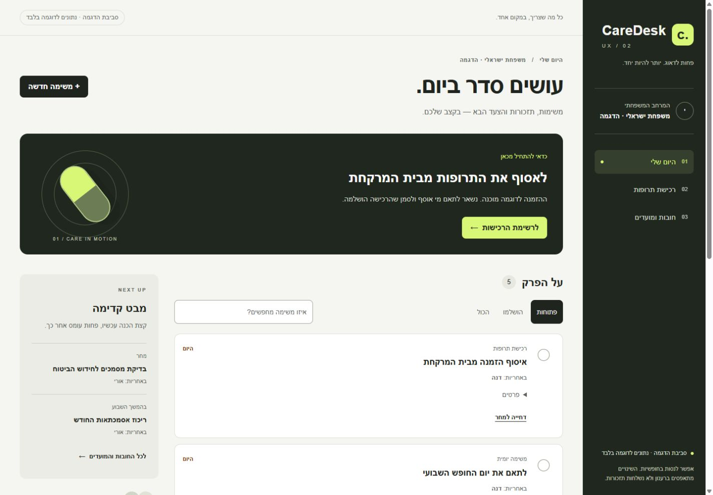
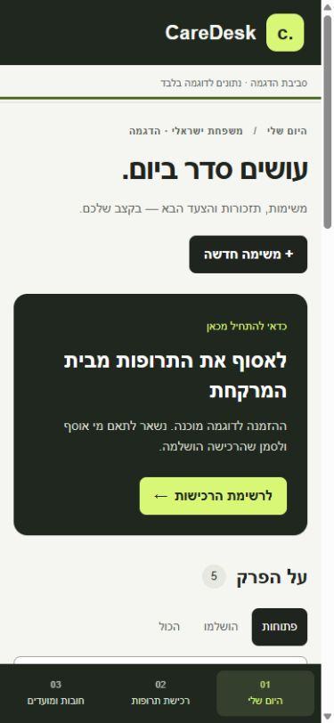

# CareDesk UX V2 — isolated review prototype

Issue: #133. Owner: Codex UX V2. Branch: `feature/caredesk-ux-v2`.
Status: experimental; human product/design and accessibility review required.

## Change log — 2026-10-13

Initial isolated UX V2 preview: daily work, medication purchases, obligations,
completion/reopening, reason-validated deferral, search, filters and task creation.

## Outcome and scope

An action-first Hebrew RTL workspace for daily tasks, medication purchases and
upcoming obligations. Neutral canvas, charcoal navigation and lime accents
replace the clinical pastel direction for this user-authorized exploration.
No analytics, legal calculations, medical advice, external reminders or actual
purchases are included. Labels and deadlines are explicitly synthetic.

## Architecture and isolation

The existing app uses React/Vite, authenticated routing and tenant-scoped APIs,
with application/domain/infrastructure packages and canonical PostgreSQL data.
Existing Vitest coverage includes task and medication synchronization, auth,
permissions and component accessibility; Playwright covers production journeys.

This prototype uses the existing React/TypeScript stack and shared `Button`.
Its entry is `apps/web/ux-v2/index.html`; all UI state lives in React memory.
It imports no production app, auth provider, API client, storage or business
logic. Refresh resets every change. No environment file or database is needed.
The dedicated Vite config has a separate root and `apps/web/build/ux-v2` output.
The built preview blocks network connections via CSP; Vite development keeps its
normal local hot-reload connection. Standard `pnpm build`
does not include this entry; production routes and build configuration are
unchanged. No new dependencies or lockfile changes are needed.

## Run locally

From the repository root:

```sh
pnpm install --frozen-lockfile
pnpm --filter @caredesk/ui... build
pnpm --filter @caredesk/web dev:ux-v2
```

Open `http://127.0.0.1:5182`. For a built preview:

```sh
pnpm --filter @caredesk/web build:ux-v2
pnpm --filter @caredesk/web preview:ux-v2
```

Open `http://127.0.0.1:4182`. Servers bind loopback only and use strict ports.
Do not point an existing production deployment at the prototype output.

## Review scenarios

1. Open medication purchases; complete a purchase and restore it from Completed.
2. Add a task, choose an owner/category/time, and confirm it appears.
3. Defer a task: an empty reason is rejected; a valid reason is retained in details.
4. Search, switch categories/status filters, and recover from an empty result.
5. Reload: all demo changes disappear.
6. Use keyboard alone, including skip link, forms and native details controls.
7. Review at 320, 390, 768 and 1440 pixels and with enlarged text.

## Component and state contract

`CareDeskPrototype` owns view/filter/search and synthetic items. `TaskCard`
supports completion/reopening, native details and reason-validated postponement.
`TaskForm` focuses its first field on mount, validates title and restores focus
to the trigger. Native controls preserve keyboard operation. Actions announce
their result through a live region. Cards include text status, owner and source.
Empty/search, form validation and success states are implemented. Loading,
network-error, offline and permission-denied states are not simulated because
there is no server or protected operation in this in-memory prototype.

All copy and fixtures are in the isolated Hebrew translation resource `he.json`.
Responsive navigation moves to the bottom at narrow widths. Targets are at
least 44px; styles use logical properties and respect reduced motion.

## Experimental token proposal

Tokens are scoped to `.ux-v2`: canvas `#f5f5f1`, surface `#ffffff`, ink `#20241f`,
muted text `#61665d`, charcoal `#20271f`, lime `#d9f777`, focus `#47661a`.
Cards use 12px radius, hero 16px, controls 8px. These do not replace approved
shared tokens. Promotion requires design review and shared-token visual tests.

## Authority and synchronization

Consulted Product Specification v1.0 (action-first, tasks, synthetic prototypes),
Coding Constitution v1.0, ADRs 001–006, Database Blueprint, Rules & Workflow
Engine, Design System/Component Catalog, User Stories, AI Review Constitution,
Repository Bootstrap Plan and `SYNC_MATRIX.md`.

Applicable matrix rows: Design token and Component contract. This document,
isolated implementation and component/accessibility tests supply the proposal
and examples. Shared UI contracts and tokens remain unchanged. Product scope
is a user-authorized UX exploration, not a production module expansion: the
older spec excludes medication management, while current code has medication
pages and the current request explicitly includes purchase reminders.
No domain statuses, workflow transitions, legal rules, permissions, canonical
entities or persistence authority change. No migration or data rollback is
needed. Remove the entry and additive scripts to remove the experiment.

## Limitations and next step

Hebrew-only prototype; no persistence, notifications, audit writes or backend
integration. Dates are relative demo labels, not legal deadlines. Completion
does not certify payment, compliance or medication administration. Review the
visual direction and interactions before separately scoping authenticated
integration. No merge or production deployment is authorized.

## Validation evidence

- `pnpm check`: PASS (format, architecture guardrails, lint, build, typecheck,
  all 1,813 tests across 14 packages; 801 web and 433 API tests).
- Six new component tests cover purchase completion/restoration, task validation,
  focus restoration, deferral reason, filtering/empty state, reset and axe checks.
- `pnpm --filter @caredesk/web build:ux-v2`: PASS. Both documented local dev and
  built preview entrypoints rendered in a browser.
- Chromium visual review at 320, 390, 768 and 1440px: no horizontal overflow;
  measured visible controls at 320px meet 44px minimum targets.
- Browser interaction: Space completes/reopens purchases; Enter opens/submits
  task creation; first-field and trigger focus verified. Console errors: none
  in the final built preview.
- Production web build retained the same asset hashes as the pre-change build.
- Full production Playwright journeys and live PostgreSQL RLS were not run:
  this change adds no production runtime, DB, auth or API behavior. Existing
  in-memory API, storage, auth and architecture suites passed.
- Existing warnings: production bundle exceeds 500kB; jsdom does not implement
  canvas for axe color-contrast calculation. Automated axe checks do not replace
  human design/accessibility review.




